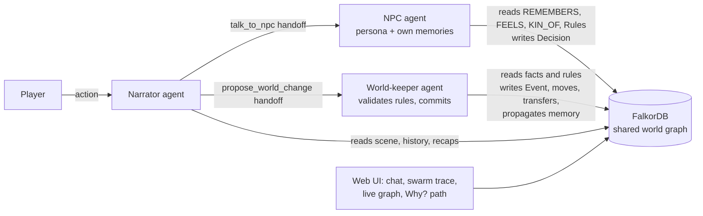

# ⚒ Emberfall: a game-master swarm with a long memory

**Track: 02, Agent Memory & Coordination** · Graph Hacks: Context for AI Agents (WeMakeDevs × FalkorDB)

Three AI agents run a tabletop RPG together: a **Narrator**, **NPC agents** and a **World-keeper**. They share one
FalkorDB graph of characters, places, items, factions, past events and their own decisions. NPCs remember what
the players did to them, *and to their family*, sessions ago, and the world stays consistent.

> **The wow moment:** in session 3 Kael asks Grimma the blacksmith to forge a moonsteel blade. She refuses,
> because in **session 1** Kael mocked her **brother** Borin in a tavern she was never in. Click **🔍 Why?** to see
> the exact path in the graph:
>
> `Kael —PERFORMED→ 📜 S1: mocked Borin —TARGETED→ Borin —KIN_OF(brother)→ Grimma`
>
> Make amends with Borin (apologise and give him a gift) and Grimma changes her mind. The graph propagated that too.

## Why a graph (and why it does real work)

Nothing about the world lives in prompts or Python dictionaries. Each agent pulls its context from FalkorDB with
Cypher and writes its results back. Turn FalkorDB off and the agents have no memory, no relationships, no
rules and no way to coordinate.

| Track 2 focus area | How Emberfall does it |
|---|---|
| **Episodic memory** | `(:Event)` nodes for deeds, linked to `(:Session)`; `(npc)-[:REMEMBERS {via, weight}]->(event)` |
| **Semantic memory** | `(npc)-[:FEELS {score}]->(player)` attitudes recomputed on each event; LLM session recaps on `(:Session).summary` |
| **Procedural memory** | `(:Rule)-[:GOVERNS]->(faction or npc)` codes that NPCs must apply; world rules the World-keeper enforces |
| **Persistent conversation history** | `(:Message)-[:IN_SESSION]->(:Session)`, sessions chained by `[:NEXT]` |
| **Shared state & handoffs** | Narrator → NPC (`talk_to_npc`) and Narrator → World-keeper (`propose_world_change`). Handoffs carry only intent; every agent reads state from the graph itself |
| **Memory that updates over time** | Graph traversal spreads gossip: target → witnesses at the location → kin → faction-mates, with decaying weight |
| **Separate memory per tenant** | Each campaign is its own FalkorDB graph (`dnd_<campaign>`). Turns are serialized per campaign, and campaigns run in parallel |
| **Traceable decisions** | `(:Decision)-[:BASED_ON]->(:Event)`, `-[:APPLIED]->(:Rule)`. NPCs can only cite events that exist in *their* memory; fabricated IDs are dropped |

## Architecture



Each turn: the Narrator reads the scene and history from the graph. It hands off to the NPC agent, which decides
from its own memory subgraph and writes a `Decision` linked to the evidence. It then hands off to the World-keeper,
which validates the proposed changes (location, ownership, liveness, roads) and commits them. The UI shows every
handoff and every Cypher query in the **swarm trace**.

Agents run on **Groq** (free tier; default model `openai/gpt-oss-120b`, set by `GROQ_MODEL`) through a manual
tool-calling loop in [app/agents.py](app/agents.py). The whole stack is free: FalkorDB (open source, or the free
FalkorDB Cloud tier) plus a free Groq API key. **Without a key** the same graph flow runs through a deterministic
offline rules engine, so the demo always works.

## Graph data model

```
(:Player {id, name, description})
(:NPC {id, name, role, persona, alive})
(:Location {id, name, description})
(:Item {id, name})
(:Faction {id, name})
(:Rule {id, scope: world|faction|npc, text})
(:Session {id, number, status: active|closed, summary})
(:Event {id, description, kind, sentiment -3..+3, session, ts})
(:Decision {id, verdict: help|refuse|negotiate|neutral, reasoning, request, session})
(:Message {id, agent, speaker, text, ts})

(Player|NPC)-[:LOCATED_AT]->(Location)        (Location)-[:CONNECTED_TO]-(Location)
(Player|NPC)-[:OWNS]->(Item)                    (NPC)-[:MEMBER_OF]->(Faction)
(NPC)-[:KIN_OF {relation}]->(NPC)               (Faction)-[:ALLIED_WITH|HOSTILE_TO]->(Faction)
(Rule)-[:GOVERNS]->(Faction|NPC)
(Player)-[:PERFORMED]->(Event)-[:TARGETED]->(NPC)      (Event)-[:AT]->(Location)
(Event)-[:IN_SESSION]->(Session)-[:NEXT]->(Session)
(NPC)-[:REMEMBERS {via: firsthand|witness|kin|faction, weight}]->(Event)
(NPC)-[:FEELS {score}]->(Player)
(NPC)-[:MADE]->(Decision)-[:TOWARD]->(Player)
(Decision)-[:BASED_ON]->(Event)   (Decision)-[:APPLIED]->(Rule)   (Decision)-[:IN_SESSION]->(Session)
(Message)-[:IN_SESSION]->(Session)
```

## The Cypher the product depends on

All queries live in [app/graph.py](app/graph.py) (`QUERIES`), and `GET /api/queries` lists them. The key ones:

**Explain a decision (the "Why?" path):** a variable-length traversal from the player's deed to the NPC who judged them.
```cypher
MATCH (n:NPC)-[:MADE]->(d:Decision {id:$did})-[:TOWARD]->(p:Player)
MATCH (d)-[:BASED_ON]->(e:Event)
MATCH path = (p)-[:PERFORMED]->(e)-[:TARGETED]->(t)-[:KIN_OF|MEMBER_OF*0..2]-(n)
RETURN path, e.id AS event_id ORDER BY length(path) ASC
```

**Memory propagation (gossip)**, run by the World-keeper on every committed event:
```cypher
MATCH (e:Event {id:$eid})-[:TARGETED]->(t:NPC)
MERGE (t)-[r:REMEMBERS]->(e) ON CREATE SET r.via = 'firsthand', r.weight = 1.0;

MATCH (e:Event {id:$eid})-[:AT]->(l:Location)<-[:LOCATED_AT]-(w:NPC)
MERGE (w)-[r:REMEMBERS]->(e) ON CREATE SET r.via = 'witness', r.weight = 0.6;

MATCH (e:Event {id:$eid})-[:TARGETED]->(:NPC)-[:KIN_OF]-(k:NPC)
MERGE (k)-[r:REMEMBERS]->(e) ON CREATE SET r.via = 'kin', r.weight = 0.9;

MATCH (e:Event {id:$eid})-[:TARGETED]->(:NPC)-[:MEMBER_OF]->(f:Faction)<-[:MEMBER_OF]-(m:NPC)
MERGE (m)-[r:REMEMBERS]->(e) ON CREATE SET r.via = 'faction', r.weight = 0.4;
```

**Attitude update (semantic memory derived from episodic memory):**
```cypher
MATCH (n:NPC)-[r:REMEMBERS]->(e:Event {id:$eid})<-[:PERFORMED]-(p:Player)
MERGE (n)-[f:FEELS]->(p) ON CREATE SET f.score = 0.0
SET f.score = f.score + e.sentiment * r.weight
```

**NPC recall**, the only memory an NPC agent is given:
```cypher
MATCH (n:NPC {id:$nid})-[m:REMEMBERS]->(e:Event)<-[:PERFORMED]-(p:Player {id:$pid})
MATCH (e)-[:IN_SESSION]->(s:Session)
OPTIONAL MATCH (e)-[:TARGETED]->(t)
RETURN e.id, e.description, e.sentiment, s.number, m.via, t.name ORDER BY s.number, e.ts
```

**Procedural memory**, the rules governing an NPC directly or through its faction:
```cypher
MATCH (n:NPC {id:$nid}) MATCH (r:Rule)-[:GOVERNS]->(t)
WHERE t = n OR (n)-[:MEMBER_OF]->(t) RETURN r.id, r.text
```

**Consistency writes**, which return zero rows when invalid so the World-keeper rejects the change:
```cypher
// travel: shortest road route, rejected if no road connects the two places
MATCH (p:Player {id:$pid})-[:LOCATED_AT]->(a:Location), (b:Location {id:$lid})
MATCH path = (a)-[:CONNECTED_TO*1..8]-(b)
RETURN [n IN nodes(path) | n.name] AS route, length(path) AS hops ORDER BY hops ASC LIMIT 1

MATCH (from {id:$from_id})-[o:OWNS]->(i:Item {id:$item_id}), (to {id:$to_id})
DELETE o CREATE (to)-[:OWNS]->(i) RETURN i.name
```

## Run it

### Option A: Docker Compose (FalkorDB and the app)
```bash
cp .env.example .env            # paste your free GROQ_API_KEY (https://console.groq.com/keys)
docker compose up --build
# open http://localhost:8000   ·   FalkorDB Browser at http://localhost:3001
```

### Option B: local Python
```bash
docker run -d -p 6379:6379 -p 3001:3000 falkordb/falkordb:latest
pip install -r requirements.txt
cp .env.example .env                  # set GROQ_API_KEY; leave empty for the offline rules engine
uvicorn app.main:app --port 8000
```

The first page load seeds a demo campaign. **Load demo** resets it; **New fresh campaign** creates a new tenant graph
starting at session 1 with no history.

## Demo script (about 2 minutes)

1. **Load demo.** The session chips show recaps of sessions 1 and 2 (hover them). Kael is in Emberfall Square.
2. As Kael: *"Grimma, forge me a blade"*. The World-keeper blocks it because Grimma isn't here (world rule).
3. *"go to the Rusty Anvil"*, then *"Grimma, I need a moonsteel blade to kill the thing in your mine. Will you forge one?"*
   She **REFUSES** and names the session 1 insult to her brother.
4. Click **🔍 Why?** The graph dims and the gold path lights up: Kael → S1 insult → Borin → KIN_OF(brother) → Grimma,
   with the Kin-oath rule and the Cypher that found it.
5. Switch to **Lyra** and ask the same thing. She has no history with the Ironroots, so Grimma deals with her.
   Memory is per player.
6. *"go to Ironroot Mine"*. The World-keeper routes Kael along the shortest road path (Anvil → Square → Old Mill Road
   → Mine). Then *"Borin, I am truly sorry for that song. Please take this Pouch of 50 Gold as amends."* The World-keeper
   commits the apology, the gift and the item transfer, and the memory spreads to Grimma through `KIN_OF`.
7. *"go to the Rusty Anvil"* and ask Grimma again. She now agrees. Click **End session**: the World-keeper writes the
   recap into the graph for next time.

## Repo layout

```
app/graph.py    FalkorDB layer: every Cypher query, memory propagation, tenant-per-graph
app/agents.py   Narrator / NPC / World-keeper agents, handoffs, offline engine, explain()
app/seed.py     The town of Emberfall (demo: sessions 1-2 pre-played; fresh: blank history)
app/main.py     FastAPI endpoints
static/index.html  UI: chat, swarm trace, vis-network graph, Why? path explorer
```
## AI Assist coding
Claude code used to build some parts of the project to speed up the process
